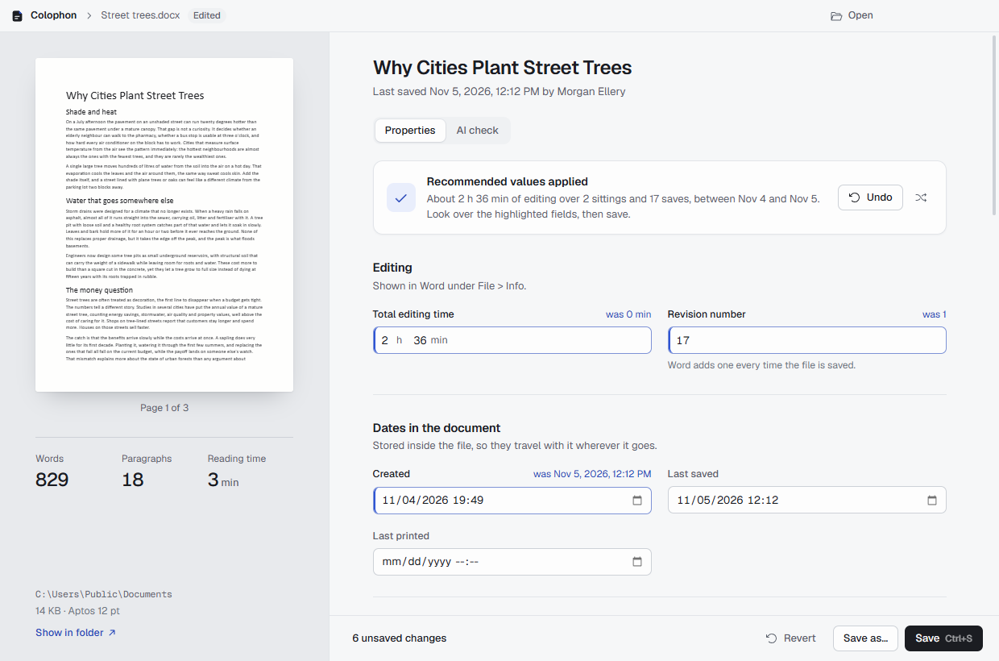
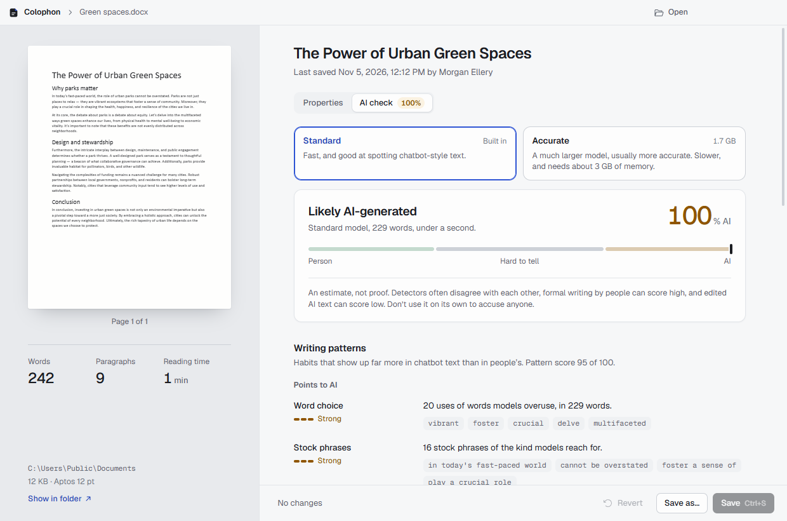

# Colophon

A Windows app for reading and editing the properties a Word document carries around with it.



Every `.docx` keeps a record of itself: who wrote it, when it was created and last saved, how many
minutes it has been open for editing, how many times it has been saved, its word and page counts,
and the template and application that made it. File Explorer adds its own created, modified and
accessed dates on top. Colophon puts all of that on one screen, lets you change any of it, and
writes it back without touching the document's content.

## Features

- **Every property in one place.** Total editing time, revision number, created, last saved and
  last printed dates, author, company, title, tags, comments, and the counts Word shows under
  File > Info.
- **File dates as well.** Date created, modified and accessed, exactly as Explorer shows them.
  Saving applies them as set, so a save never quietly moves "Date modified" to now.
- **Recommended values.** One button fills in what a document of that length usually carries
  when it was written by hand in Word: editing time at a normal drafting pace, a matching save
  count, a created date spread over the right number of sittings, and counts that agree with the
  text. The shuffle button offers another variation.
- **Consistency checks.** Flags values that don't add up, such as more editing time than fits
  between the created and last saved dates, or a stored word count that disagrees with the text.
- **AI check.** Scores the text with a trained AI-text detector that runs on your machine, section
  by section, and lists the writing patterns behind the result.
- **Careful with files.** Only the two property parts of the package are rewritten. The body,
  styles and every other part stay byte for byte as they were, and nothing is written until you
  press Save.

## AI check



Two detectors are available, and the choice is remembered:

| | Model | Size | Speed |
| --- | --- | --- | --- |
| Standard | [Fakespot RoBERTa-base](https://huggingface.co/fakespot-ai/roberta-base-ai-text-detection-v1) | 126 MB, ships with the app | under a second |
| Accurate | [Desklib DeBERTa-v3-large](https://huggingface.co/desklib/ai-text-detector-v1.01) | 1.7 GB, downloaded on first use | about 10 s, ~3 GB of memory |

Both run locally through ONNX Runtime, so no text leaves the computer. Downloads come from pinned
Hugging Face revisions and each file is checked against its SHA-256 before it is used. Long
documents are split at sentence boundaries into windows the model can read, and the overall score
is weighted by section length.

Under the score, a pattern reading explains what the text looks like: vocabulary language models
overuse, stock phrases, sentences of even length, linking-word openers, em dashes and lists of
three, plus the typos and first-person voice that point the other way.

No detector is proof of anything. They disagree with each other, formal human writing can score
high, and edited AI text can score low.

## Getting started

You need Windows 10 or 11 and Node.js 22 or newer.

```bash
npm install
npm run models
npm start
```

`npm run models` fetches the Standard detector into `models/` (about 126 MB). npm 11 skips install
scripts, so if Electron reports that its binary is missing, run `node node_modules/electron/install.js`
once.

| Command | |
| --- | --- |
| `npm start` | Build and open the app |
| `npm test` | Run the test suite |
| `npm run typecheck` | Type-check without emitting |
| `npm run models` | Download the bundled detector model |
| `npm run package` | Build `release/Colophon-win32-x64/Colophon.exe` |
| `npm run icon` | Re-render `build/icon.ico` from `build/icon.svg` |

To open documents from Explorer, right-click a `.docx`, choose **Open with**, and pick `Colophon.exe`.

## How it works

A `.docx` is a zip package. Colophon follows the package relationships to find the core and
extended property parts rather than assuming their paths, edits them as XML, and writes them back
in the order Word uses. Replaced zip entries keep their original timestamps, which Word sets to
1980-01-01.

Text statistics come from a single pass over `word/document.xml` that skips deleted text, field
codes and the fallback copies Office writes for text boxes. The test suite checks the counts
against a document saved by Word 365. Page counts use the page-break markers Word leaves behind
when they exist, and an estimate from the default font and line spacing when they don't.

Node can set a file's access and modification times but not its creation time, so that one goes
through .NET on Windows. Windows Search tends to read a freshly saved file a few seconds later,
which moves its access date; Colophon watches for that briefly after a save and puts it back.

The detectors run in a separate Electron utility process that starts with the first check and
exits a few minutes after the last one, so a native failure can only end the check, and the large
model's memory is given back. ONNX Runtime needs the Visual C++ runtime, which a fresh Windows
install doesn't have; the packaged app carries those DLLs next to the runtime. The tokenizers
(byte-level BPE for RoBERTa, SentencePiece unigram for DeBERTa) are implemented in `src/core` and
were checked token for token against Hugging Face `tokenizers`.

## Project layout

```
src/core       .docx reading and writing, text analysis, recommendations, checks,
               writing patterns, tokenizers and sectioning (no Electron)
src/main       window, dialogs, saving and file dates, model downloads, inference
src/renderer   React interface
src/shared     types and definitions used on both sides
test           node:test suites; fixtures/essay.docx was saved by Word 365
scripts        build, packaging, model download, icon rendering
```

## License

MIT, see [LICENSE](LICENSE). The detection models carry their own licenses: Apache-2.0 for the
Fakespot model and MIT for the Desklib model.
